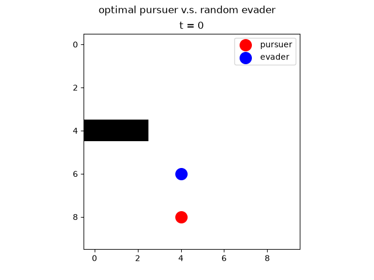
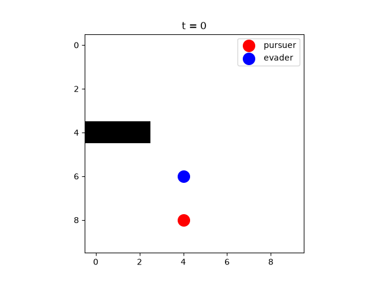
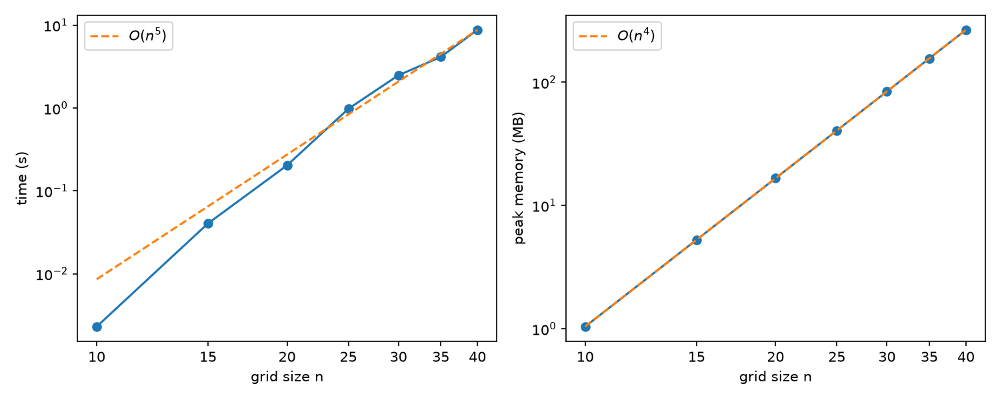

# Pursuit-Evasion on a Grid: Minimax Value Iteration

A pursuer chases an evader on a discretized grid with obstacles. This project computes the optimal strategies for both players with minimax value iteration, compares them with random play, and measures how the computational cost grows as the grid gets finer.

## Motivation

Pursuit-evasion games are a classic testbed for motion planning and decision making between two agents with opposing goals. Discretizing the workspace into a grid makes the game exactly solvable, but the joint state space grows quickly with the resolution. This project asks two questions:

1. What do optimal pursuit and evasion strategies look like on a small grid?
2. How fast does the cost of exact solving grow, and when does it stop being practical?

## Setup

| Item | Setting |
|---|---|
| Grid | $n \times n$ cells, with obstacles |
| Moves | 8 directions or stay (9 actions) for both players |
| Turn order | Pursuer moves first, then the players alternate |
| Capture | Both players occupy the same cell |
| Episode end | Capture, or `max_steps` reached |

Each move by either player counts as one step.

## Method

The value $V$ of a state is the number of steps until capture when both players play optimally. The pursuer minimizes it and the evader maximizes it. With $N[x, a]$ denoting the cell reached from cell $x$ by action $a$:

$$V_0[p, e] = 1 + \min_{a} V_1\big[N[p, a],\ e\big] \qquad \text{(pursuer to move)}$$

$$V_1[p, e] = 1 + \max_{a} V_0\big[p,\ N[e, a]\big] \qquad \text{(evader to move)}$$

Captured states ($p = e$) have value 0. All other states start at $\infty$ and are updated until nothing changes. After $k$ iterations, the finite values are exactly the states from which capture is guaranteed within $k$ steps. States that stay at $\infty$ are those from which the evader can escape forever.

Both updates are vectorized with NumPy fancy indexing over a precomputed neighbor table, so one iteration processes all $2n^4$ states at once. Optimal policies are read off the converged tables with `argmin` and `argmax`.

## Results

### Optimal vs. Random Play

10 × 10 grid with a wall attached to the left border, 1,000 episodes per pairing:

| Pursuer | Evader | Capture rate | Avg. steps to capture |
|---|---|---|---|
| Random | Random | 38.1% | 42.7 |
| Optimal | Random | 100.0% | 8.8 |
| Optimal | Optimal | 100.0% | 12.5 |

In optimal-vs-optimal play, the simulated number of steps matches the value predicted by $V_0$ at the start state. Against a random evader, the optimal pursuer captures faster (8.8 vs. 12.5 steps), because the optimal evader actively delays capture.

| Optimal vs. Random | Optimal vs. Optimal |
|---|---|
|  |  |

### Finding: a single hole lets the evader escape forever

Optimal pursuer vs. optimal evader on three 10 × 10 maps, 1,000 episodes each:

| Map | Obstacles | Capture rate | Avg. steps to capture |
|---|---|---|---|
| No obstacles | none | 100.0% | 12.5 |
| Wall | attached to the left border | 100.0% | 12.5 |
| Hole | 2 cells in the middle | 52.6% | 9.8 |

With an obstacle in the middle of the grid, 49.5% of the states (both players on free cells) have infinite value, and only about half of the episodes end in capture: the evader reaches the obstacle and circles it, and a pursuer of equal speed can never close the gap. This matches the theory of cops and robbers games on graphs, where a hole lets the robber circle around it indefinitely. Obstacles in the main experiments are therefore attached to the border.

### Scaling



| $n$ | States | Iterations | Time (s) | Peak memory (MB) | Max steps to capture |
|---|---|---|---|---|---|
| 10 | 20,000 | 19 | 0.002 | 1.0 | 17 |
| 15 | 101,250 | 29 | 0.041 | 5.3 | 27 |
| 20 | 320,000 | 39 | 0.204 | 16.6 | 37 |
| 25 | 781,250 | 49 | 0.980 | 40.6 | 47 |
| 30 | 1,620,000 | 59 | 2.488 | 84.2 | 57 |
| 35 | 3,001,250 | 69 | 4.140 | 156.1 | 67 |
| 40 | 5,120,000 | 79 | 8.798 | 266.2 | 77 |

Memory grows as $O(n^4)$ (fitted slope 4.00) and runtime as roughly $O(n^5)$ (fitted slope 5.26 for $n \geq 20$), matching the analysis: the joint state space has $2n^4$ states, and the number of iterations grows linearly with $n$. On these maps the iterations are exactly $2n - 1$ and the longest capture takes $2n - 3$ steps.  

Peak memory agrees with the estimate of about $13 n^4$ float64 values (266 MB at $n = 40$): four value tables plus the $(n^2, 9, n^2)$ intermediate array of the vectorized update, which dominates.  

Small grids run faster than the trend predicts, likely because their arrays fit into the CPU cache.

Extrapolating from $n = 40$ to $n = 100$ gives about 18 minutes and 10 GB of memory, so memory becomes the bottleneck first. 

> Time: $$8.8 \times 2.5^{5.26} \approx 1080 s$$  
> 
> Memory: $$266 \times 2.5^4 \approx 10{,}400 MB$$   

This motivates approximate methods, such as self-play reinforcement learning, for finer or continuous state spaces.

## Repository structure

```
env.py          Grid environment (neighbor table, reset, step)
solver.py       Minimax value iteration and optimal policies
baseline.py     Random policy and evaluation
visualize.py    Frame rendering and GIF export
scaling.py      Scaling experiment
test_env.py     Tests for the environment
test_solver.py  Tests for the solver
outputs/        Figures, GIFs and experiment results (CSV)
```

## How to run

```bash
python -m venv .venv
.venv\Scripts\activate          # macOS/Linux: source .venv/bin/activate
pip install -r requirements.txt

python test_env.py
python test_solver.py
python solver.py                # policy comparison
python visualize.py             # GIFs
python scaling.py               # scaling experiment
```

All figures, GIFs and results are saved to `outputs/`.

